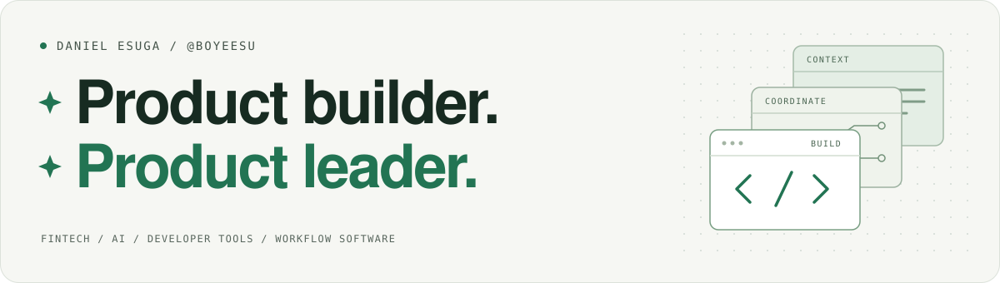

<picture>
  <source media="(prefers-color-scheme: dark)" srcset="assets/header-dark.svg">
  <source media="(prefers-color-scheme: light)" srcset="assets/header-light.svg">
  
</picture>

 

I'm **Daniel Esuga**, a builder based in **Nigeria**. I build open-source tools that help developers understand codebases, coordinate coding agents, and turn complex workflows into usable products.

My work spans **developer tools**, **agent infrastructure**, and **practical AI**.

[Explore my projects](https://github.com/boyeesu?tab=repositories) · [Visit Kourti](https://kourti.com)

## Selected work

<table>
  <tr>
    <td width="50%" valign="top">
      <h3><a href="https://github.com/boyeesu/ProDocs">ProDocs ↗</a></h3>
      
<strong>Make the codebase explain itself.</strong>

      
Evidence-backed documentation and scoped context for developers and coding agents. Connect code, decisions, and product knowledge in one local-first system.

      
CODEBASE CONTEXT · DOCUMENTATION

    </td>
    <td width="50%" valign="top">
      <h3><a href="https://github.com/boyeesu/murmur">Murmur ↗</a></h3>
      
<strong>Give parallel coding tasks shared context.</strong>

      
A local workspace for task coordination, shared decisions, isolated Git worktrees, and reviewed integration. Managed Claude Code and Codex launches are in alpha.

      
AGENT COORDINATION · GIT WORKFLOWS

    </td>
  </tr>
  <tr>
    <td width="50%" valign="top">
      <h3><a href="https://github.com/boyeesu/nerve">Nerve ↗</a></h3>
      
<strong>See the fleet. Understand the work.</strong>

      
An open-source visual command center for OpenClaw and Hermes agents. Bring agent activity, runs, and operator controls into one interface. Currently in public alpha.

      
AGENT OPERATIONS · OBSERVABILITY

    </td>
    <td width="50%" valign="top">
      <h3><a href="https://github.com/boyeesu/cve-skill-forge">CVE Skill Forge ↗</a></h3>
      
<strong>Turn security intelligence into useful guidance.</strong>

      
Compile CVE intelligence into evidence-backed security skill updates, with reviewable candidates and human-controlled promotion. Currently in public alpha.

      
SECURITY TOOLING · AGENT SKILLS

    </td>
  </tr>
</table>

### Also building: Kourti Legal

An open-source workspace for matters, documents, clients, and deadlines — bringing practical AI into legal workflows.

**[Explore the source ↗](https://github.com/boyeesu/Kourti)** · **[Visit kourti.com ↗](https://kourti.com)**

## What connects the work

- **Context:** make code, decisions, and evidence easier to find and understand.
- **Coordination:** help people and agents work together with clearer boundaries.
- **Usability:** turn complex systems into tools people can actually work with.

**Across these projects:** TypeScript · JavaScript · Python · Node.js · React · PostgreSQL

## Build with me

Trying one of these projects? Reproducible bug reports, thoughtful feedback, and focused contributions are welcome. Start with the project's README and open an issue in the relevant repository.

**[Find a project to explore ↗](https://github.com/boyeesu?tab=repositories)**

---

Built in Nigeria. Shared in the open.
